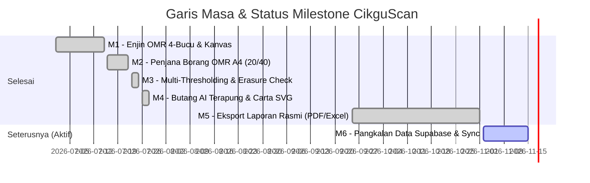

# 🗺️ ROADMAP PEMBANGUNAN: CikguScan (Smart OMR Sheet Scanner PWA)

> **Versi Semasa:** v6.2.0 (AI Chat & Interactive SVG Chart Era)  
> **Status Pelaksanaan:** Aktif / Fasa Analisis & Laporan  
> **Sasaran Utama:** Sistem Pemeriksaan Kertas OMR Pantas Berasaskan Kamera Telefon & Web PWA

---

## 📈 Gambaran Keseluruhan Milestone (Milestone Health Tracker)

---

## 🏁 Ringkasan Pencapaian & Fasa Siap (Completed Milestones)

### ✅ Milestone 1: Enjin Pengesanan & Pembetulan Homografi (v1.0 - v3.0)
* Pengesanan kontur 4 titik hitam sudut kertas A4 secara automatik.
* Pembetulan perspektif (*warpPerspective*) ke kanvas 2D standard.
* Sokongan pensuisan kamera hadapan/belakang dan pengaktifan lampu suluh (*torch*).

### ✅ Milestone 2: Format Borang OMR & Cetakan Auto A4 (v4.0)
* Templat OMR automatik: 20 soalan (Mod Potret) dan 40 soalan (Mod Landskap).
* Susun atur petak nombor, abjad bubble (A, B, C, D), dan ruang nama murid serta nombor kad pengenalan.

### ✅ Milestone 3: Ketepatan Imbasan & Pengesanan Kesan Pemadaman (v5.0)
* Algoritma *Multi-Thresholding* bagi menangani pencahayaan berbeza-beza di dalam bilik darjah.
* Pengecaman tanda padam pensel getah (*erasure detection*) untuk mengurangkan ralat bacaan palsu.
* Pengecapan imej nama murid dan penyimpanan dalam IndexedDB cache.

### ✅ Milestone 4: Pembantu Terapung AI & Carta Interaktif SVG (v6.0 - v6.2)
* Butang terapung bulat `#btn-floating-ai` di sudut kanan bawah skrin.
* Pengekstrakan blok kod JSON `chart` kepada carta SVG dinamik (Bar / Line / Dotted) terus dalam modal sembang.
* Sokongan Google Gemini Vision API (`gemini-2.5-flash`) untuk pengesahan tanda lorekan kabur.

### ✅ Milestone 5: Eksport Laporan Analisis Rasmi (v6.3)
* [x] **Eksport Microsoft Excel (`.xlsx`):** Muat turun fail `.xlsx` multi-lembaran lengkap dengan lembaran Markah Individu, Analisis Item & Distraktor (pilihan A, B, C, D), dan Ringkasan Pentaksiran serta taburan gred KPM.
* [x] **Penjanaan PDF Laporan Analisis Pentaksiran:** Dokumen A4 rasmi mengandungi nama sekolah/pentaksiran, kelas, KPI kelulusan, ringkasan murid cemerlang, murid perlukan bimbingan, analisis item, serta ruangan pengesahan pentadbir/guru.
* [x] **Analisis Distraktor Soalan:** Statistik peratusan pemilihan setiap pilihan jawapan beserta pengiraan Indeks Kesukaran ($p$) dan Indeks Diskriminasi ($d$).

---

## 🎯 Sasaran Milestone Seterusnya (Upcoming Milestones)

### ⚡ Milestone 6: Migrasi Supabase & Realtime Cloud Sync (Sprint Seterusnya)
* [ ] **Penyediaan Skema PostgreSQL:** Menghubungkan CikguScan ke pangkalan data Supabase seperti projek saudara Scan-HW.
* [ ] **Penyegerakan Segera (Realtime Subscription):** Data markah disegerakkan secara langsung merentas pelayar dan peranti guru.
* [ ] **Sokongan Luar Talian Penuh:** Penyimpanan data luar talian dengan auto-sync sebaik menerima capaian internet.

---

## 🛠️ Matriks Keutamaan & Pelan Tindakan Segera

| Keutamaan | Tindakan / Tugasan | Modul Terlibat | Anggaran Usaha |
| :---: | :--- | :--- | :---: |
| 🔴 **P0 (Kritikal)** | Tambah fungsi eksport markah kelas ke Excel (`.xlsx`) | `src/main.ts`, `index.html` | 1.5 Jam |
| 🟠 **P1 (Tinggi)** | Reka bentuk templat laporan analisis pentaksiran format PDF A4 | `src/main.ts`, print styles | 2 Jam |
| 🟡 **P2 (Sederhana)** | Integrasi sokongan API Supabase untuk rekod berpusat | `src/supabase.ts`, `localDb.ts` | 3 Jam |
| 🟢 **P3 (Rendah)** | Tambah kesan bunyi (beep) semasa imbasan OMR berjaya | `src/main.ts` | 30 Minit |
